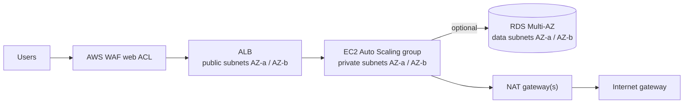

# chq-nls-wordpress-pilot

NLS WordPress pilot – multi-tier AWS reference architecture (CloudFormation).

Repeatable CloudFormation solution for a multi-AZ, multi-tier web architecture:

- **Edge:** AWS WAF (regional web ACL) → internet-facing Application Load Balancer
- **App:** EC2 Auto Scaling group in **private** subnets across two AZs (no public IPs, no SSH; access via SSM Session Manager)
- **Data (optional):** isolated data subnets and an Amazon RDS instance (PostgreSQL or MySQL), switched on by parameter



## Layout

```
templates/
  main.yaml       Root stack – the only template you deploy; wires the nested stacks together
  network.yaml    VPC, public / private / (optional) data subnets, IGW, NAT, S3 endpoint, flow logs
  security.yaml   Security groups chained ALB -> App -> DB
  alb.yaml        ALB, target group, HTTP listener (+ HTTPS listener when a certificate is given)
  waf.yaml        WAF web ACL (rate limit + AWS managed rules), ALB association, logging
  app.yaml        IAM role, launch template (AL2023, IMDSv2, encrypted gp3), ASG, CPU scaling
  database.yaml   (optional) RDS subnet group + encrypted RDS instance, password in Secrets Manager
params/
  sandbox.json        Low-cost settings for the Innovation Sandbox account
  prod.example.json   Example production settings (copy to e.g. prod.json and edit)
scripts/
  deploy.ps1      Windows / PowerShell deploy
  deploy.sh       Bash deploy (e.g. AWS CloudShell); needs jq
```

Each environment = **one root stack + one params file**. To create another environment, copy a params file,
change `StackName`, `EnvironmentName` and (if the VPCs will ever be peered or connected) the CIDRs, then deploy.

## Optional components

| Parameter | Effect |
|---|---|
| `CreateDataSubnets=true` | Adds two isolated data subnets (no internet route) with their own route table |
| `CreateDatabase=true` | Adds RDS in the data subnets, DB security group and the WAF SQLi rule group, and grants the EC2 role read access to the DB secret. **Data subnets are created automatically.** |
| `CertificateArn=<acm arn>` | Adds an HTTPS listener (TLS 1.2/1.3 policy); HTTP redirects to HTTPS |
| `NatGatewayMode=Single` | One NAT gateway instead of one per AZ (cheaper; not AZ-resilient) |
| `EnableFlowLogs` / `EnableWafLogging` | VPC flow logs and WAF logs to CloudWatch Logs |

These can be switched on later with a normal update. For example, set `CreateDatabase` to `true` in the params file and redeploy.

## Deploy

Prerequisites: AWS CLI v2 with credentials for the target account. The scripts create an S3 bucket
`cfn-artifacts-<account>-<region>` (if it does not exist) to hold the packaged nested templates.

```powershell
# Windows
./scripts/deploy.ps1 -Environment sandbox                    # deploy / update
./scripts/deploy.ps1 -Environment sandbox -ValidateOnly      # validate templates only
./scripts/deploy.ps1 -Environment prod -AwsProfile nls-prod  # named CLI profile
```

```bash
# CloudShell / Linux / macOS
./scripts/deploy.sh sandbox
```

The same command is used for create and update. CloudFormation applies a change set, and nothing changes if
nothing differs. Outputs include `ApplicationUrl`.

Optional local linting: `pip install cfn-lint` then `cfn-lint --ignore-checks W3002 -- templates/*.yaml`
(W3002 just notes that `main.yaml` relies on `aws cloudformation package`, which the scripts do).

## Testing in the AWS Innovation Sandbox account

1. Get CLI credentials for the sandbox account (IAM Identity Center "Command line or programmatic access",
   or upload this folder to **CloudShell** and use `deploy.sh`).
2. Check the region in `params/sandbox.json` (`eu-west-2`) is allowed by the sandbox SCPs; change it if not.
3. `./scripts/deploy.ps1 -Environment sandbox` and allow about 10–15 minutes (add about 10 minutes with RDS).
4. Browse to `ApplicationUrl`. The page shows the instance ID and AZ, so refreshing should show both AZs.
   `/health` returns `ok`.
5. Tests worth doing:
   - **Private EC2:** instances have no public IP; connect with *Systems Manager → Session Manager*.
   - **Multi-AZ:** terminate an instance or set the ASG desired count. The ASG replaces it and the ALB keeps serving.
   - **WAF:** `curl "<url>/?x=<script>alert(1)</script>"` should return `403`. Check *WAF → Web ACLs → Sampled requests*.
   - **Optional tier:** redeploy with `CreateDatabase=true` and check the RDS instance, the secret, and `/etc/app/app.env` on an instance.
6. Tear down by following [Tear down](#tear-down) below.

Cost note: NAT gateway(s), the ALB, WAF and RDS bill hourly. The sandbox params use a single NAT and no RDS,
which keeps costs within typical sandbox budgets.

## Tear down

1. **Delete the stack.**

   ```powershell
   aws cloudformation delete-stack --stack-name nls-sandbox --region eu-west-2
   aws cloudformation wait stack-delete-complete --stack-name nls-sandbox --region eu-west-2
   ```

2. **If a database was ever created, clean up what RDS leaves behind.** These steps also apply after a
   stack update that switched `CreateDatabase` from `true` to `false`.

   - **Final snapshot:** this is kept on purpose (`DeletionPolicy: Snapshot`). Delete it if the data is not needed:

     ```powershell
     aws rds describe-db-snapshots --snapshot-type manual --region eu-west-2 `
       --query "DBSnapshots[?starts_with(DBSnapshotIdentifier,'nls-sandbox-databasestack')].DBSnapshotIdentifier" --output text
     aws rds delete-db-snapshot --db-snapshot-identifier <identifier> --region eu-west-2
     ```

   - **RDS log groups:** RDS creates its own CloudWatch log groups for the exported database logs
     (`/aws/rds/instance/<db-instance-id>/postgresql`, or `/error` and `/slowquery` for MySQL).
     CloudFormation does not manage them, so they **survive stack deletion and keep logs forever**.
     The DB instance ID begins with `<stack name>-databasestack-`, so they can be found by prefix and deleted:

     ```powershell
     # PowerShell
     $groups = aws logs describe-log-groups --region eu-west-2 `
       --log-group-name-prefix /aws/rds/instance/nls-sandbox-databasestack- `
       --query 'logGroups[].logGroupName' --output text
     $groups -split '\s+' | Where-Object { $_ } | ForEach-Object {
       Write-Host "Deleting $_"; aws logs delete-log-group --log-group-name $_ --region eu-west-2
     }
     ```

     ```bash
     # Bash / CloudShell
     for g in $(aws logs describe-log-groups --region eu-west-2 \
         --log-group-name-prefix /aws/rds/instance/nls-sandbox-databasestack- \
         --query 'logGroups[].logGroupName' --output text); do
       echo "Deleting $g"; aws logs delete-log-group --log-group-name "$g" --region eu-west-2
     done
     ```

     In a long-lived environment where the logs should be kept, set a retention period instead of deleting:
     `aws logs put-retention-policy --log-group-name <name> --retention-in-days 90`.

3. **Artifact bucket (optional):** `cfn-artifacts-<account>-<region>` holds only packaged templates and is
   reused by later deploys. Remove it only when nothing else is deployed from that account and region:
   `aws s3 rb s3://cfn-artifacts-<account>-<region> --force`.

Replace `nls-sandbox` and `eu-west-2` with the stack name and region of the environment being removed.

## Design notes

- **Security:** only the ALB is reachable from the internet. The app SG accepts traffic from the ALB SG only,
  and the DB SG from the app SG only. RDS has no outbound rules and no internet route. IMDSv2 is enforced
  and EBS/RDS are encrypted. The RDS master password never appears in templates because RDS creates it in Secrets Manager.
- **Deploy safety:** the ASG uses a `CreationPolicy` / rolling `UpdatePolicy` with `cfn-signal`. A stack only
  succeeds when instances have booted the app and passed a local health check, and a bad launch template update rolls back.
- **Placeholder app:** `app.yaml` user data installs nginx with an index page and `/health`. Replace the
  marked "application" section, or swap `AmiId` for a pre-baked AMI. Runtime settings (DB host, secret ARN)
  are written to `/etc/app/app.env`.
- **Graviton:** to use arm64 instances (e.g. `t4g.*`), also set `AmiId` to
  `/aws/service/ami-amazon-linux-latest/al2023-ami-kernel-default-arm64`.
- **WAF tuning:** `AWSManagedRulesCommonRuleSet` blocks request bodies over 8 KB (`SizeRestrictions_BODY`).
  If the application accepts uploads, add a rule action override for that rule in `waf.yaml`.
- **Exports:** the root stack exports key IDs as `<EnvironmentName>-VpcId`, `-PrivateSubnetIds`, `-AppSecurityGroupId`
  and so on, so future add-on stacks can `Fn::ImportValue` them.
- **Not included (possible next steps):** ALB access logs, CloudWatch alarms/dashboard, a third AZ, Aurora,
  Route 53 / ACM certificate creation, and a CI/CD pipeline once a repo exists.
