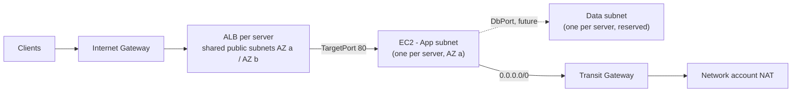

# nls-wordpress

National Library of Scotland - WordPress migration (MAP SoW v1.1). CloudFormation for the
WordPress reference architecture in the dedicated WordPress AWS account, deployed by AWS
CodePipeline from this repository.

Up to 4 WordPress servers, each migrated from an AMI and deployed into the **Customer's existing
LZA VPC** as its own stack: an App and a Data private subnet in a single AZ, each behind its own
network ACL, with outbound internet over the **Transit Gateway** to the centralised NAT Gateways
in the Network account. No VPC, NAT Gateway or Elastic IP is created in this account.

**Provided by the LZA (not touched by these stacks):** the VPC (with only its main route table,
local route only) and three Transit Gateway subnets with their own route tables, NACL and the
Transit Gateway attachment. **Created here:** the Internet Gateway, every other subnet, and their
route tables and network ACLs. The Transit Gateway subnets are used, because the App subnets'
`0.0.0.0/0 -> Transit Gateway` route egresses through the attachment in them, but nothing here
needs their IDs or CIDRs. Only the `TransitGatewayId` is needed.



## Layout

```
cf-templates/                 Synced to S3 by the pipeline; root templates are deployed per params file
  shared.yml                  Root - deployed once per environment; also the optional ACM wildcard cert (D3.3)
    shared-network.yml          public ALB subnets x2, Internet Gateway, public route table + NACL (D3.2)
    shared-security.yml         KMS CMK, alarm SNS topic, CloudWatch agent SSM document     (D3.6, D3.7)
    shared-dns.yml              Route 53 private hosted zone                                (D3.3)
  server.yml                  Root - deployed once per WordPress server
    server-network.yml          App + Data subnet, route tables (App -> TGW), App + Data NACLs (D3.2)
    server-security.yml         ALB -> EC2 -> DB security groups                           (D3.2, D3.5)
    server-compute.yml          EC2 instance, SSM-only role, private DNS record, credentials secret (D3.4, D3.6)
    server-alb.yml              ALB, target group, HTTP/HTTPS listeners                    (D3.3)
    server-waf.yml              WAF web ACL, IP sets, logging, Shield Advanced protection  (D3.3, D3.8)
    server-monitoring.yml       CloudWatch agent config + association, log groups, alarms, dashboard (D3.7)
params/<env>/
  shared.json                 Shared stack parameters + tags
  server-01.json ... -04.json One file per WordPress server
guard-rules/                  cfn-guard rules: baseline + one file per cf-templates/ template (required)
buildspec.yml                 cfn-lint + cfn-guard every template, then sync cf-templates/ to S3
buildspec-create-changeset.yml  One change set per params file matching PARAM_FILES
buildspec-execute-changeset.yml Execute those change sets in order, termination protection in prod
pipelinebuilder.yml           Bootstrap: deploys codepipeline.yml (deployed by hand once)
codepipeline.yml              Main pipeline
pipeline-params/<env>.json    Parameters for codepipeline.yml
```

Every root template's nested stacks have `UpdateReplacePolicy: Retain` and
`DeletionPolicy: RetainExceptOnCreate`. That is Retain, except when a stack's first creation fails:
then the stack is cleaned up rather than orphaned, which would leave its subnet CIDRs in use and
block the retry. Production root stacks get termination protection on every pipeline run.

## Server lifecycle: placeholder first, migrated server later

Each server stack starts with a **placeholder instance** launched from a basic Debian 12 image
(`PlaceholderInstance: "true"`). Its user data installs the SSM Agent and runs a tiny web server
on port 80, so the ALB health check, WAF, Session Manager, the CloudWatch agent and the alarms
can all be proven before any real server is migrated.

**Before the first run**, set `AmiId` in each `server-NN.json` to the current Debian 12 AMI:

```bash
aws ssm get-parameter --region eu-west-2 \
  --name /aws/service/debian/release/12/latest/amd64 --query Parameter.Value --output text
```

The AMI ID is pinned deliberately. If the template followed "latest", every new Debian release
would replace the instance on the next pipeline run.

**At migration (D3.9 / D3.10)**, in that server's params file set `AmiId` to the migrated AMI
copied into this account and encrypted with the workload KMS key (alias
`alias/nls-wordpress-prod`). Also set `PlaceholderInstance` to `"false"` and `InstanceType` to the
like-for-like type, then merge. CloudFormation **replaces** the instance and the ALB target follows.
The migrated instance gets no user data (cloud-init would otherwise re-run it on the migrated
server's first boot) and has termination protection. The placeholder instance is **kept** (because
`UpdateReplacePolicy` is Retain), so terminate it by hand afterwards. The CloudWatch agent
association re-runs against the new instance automatically.

## HTTPS certificate (D3.3)

1. Set `CertificateDomainName` in `shared.json` (e.g. `*.example.ac.uk`) and merge. ACM requests
   the certificate and the **Shared execute step waits until it is issued**. During that time the
   Customer must create the validation CNAME, shown in the ACM console (Certificate Manager →
   the certificate → Domains), on its external DNS. The record must stay in place for automatic
   renewal.
2. Copy the shared stack's `CertificateArn` output into `CertificateArn` in each
   `server-NN.json` and merge. Each ALB then gets an HTTPS listener (TLS 1.2 minimum) and HTTP
   redirects to HTTPS. Until then the ALBs serve plain HTTP, which is for infrastructure
   testing only.

## WAF (D3.3 / D3.8)

- Deployed in **count** mode (`WafRuleAction: "count"`). The Customer tests against genuine
  traffic, then set `"block"` per server **before that server's cutover**.
- `AdminAllowedCidrs` holds the Customer's approved public IPs. They must be used only by the
  Customer, not shared Scottish Government egress. With the list empty, wp-admin and
  wp-login.php are blocked for everyone once in block mode. `admin-ajax.php` stays open because
  public pages call it.
- Managed rule groups skip requests from the approved admin IPs, so the block editor and media
  uploads from the Customer are not caught by body-inspection rules.
- Bot Control (`EnableBotControl`) carries an AWS charge per web ACL plus per million requests.
- Shield Advanced (`EnableShieldAdvanced`) needs the Customer's subscription active in this
  account (SoW assumption). If it is not active, the server stack fails to create. Shield's
  automatic mitigation adds its own rule group to the web ACL, which drift detection (D3.11)
  reports on `WebAcl`. That drift is expected.

## Pipeline

A push to `main` runs the **Pipeline Builder**, which updates the main pipeline from
`codepipeline.yml`. When it succeeds, the **main pipeline** runs:

1. **PublishAndTestTemplates** - cfn-lint and cfn-guard on every template in the repo, then sync
   `cf-templates/` to the template bucket.
2. **Shared** - change set for `params/<env>/shared.json` -> stack `nls-wordpress-<env>-shared`,
   manual approval, execute.
3. **Servers** - one change set per `params/<env>/server-*.json` -> stacks
   `nls-wordpress-<env>-server-NN`, manual approval, execute one after another.

The shared stack runs first because the server stacks `Fn::ImportValue` its exports, and an
import fails at change-set creation if the export does not exist yet. Stacks with no changes are
skipped. Review the change sets (and their nested change sets) in the **CreateChangeSet(s)** build
log or the CloudFormation console before approving.

### Parameter file format

```json
{
  "Template": "server.yml",
  "Parameters": { "ApplicationName": "nls-wordpress", "...": "..." },
  "Tags": { "Environment": "prod", "...": "..." }
}
```

`Template` names the root template under `cf-templates/`. `TemplatePrefix` is injected by the
pipeline and must not be set in the file. The `Tags` are applied to the root stack, and
CloudFormation propagates them to the nested stacks and to supported resources.

**Tagging (SoW 3.3):** no `map-migrated` tag is applied. This is an AWS-to-AWS migration, so the
servers are not MAP migration credit candidates. Add any mandatory tags from the Customer's
tagging taxonomy to every params file.

### Adding a WordPress server (D3.10)

`server-01.json` to `server-03.json` exist (server 01 is the pilot, D3.9). To add a fourth, copy
`params/prod/server-03.json` to `server-04.json` and use the server 04 ranges in the CIDR plan. Change
`ServerName` (`wp02`), the `WordPressServer` tag and the four CIDRs, then merge to `main`. The
pipeline creates `nls-wordpress-prod-server-02` alongside the existing servers. More than 4
servers is a change request under SoW 3.7.

## Network design (D3.2)

### CIDR plan

The production VPC is `10.149.12.0/22`, smaller than the /20 the SoW assumes, so each server gets
a /25 rather than a /24 (each subnet is a /27 - 27 usable addresses, ample for one instance).

| Range | Use |
|---|---|
| `10.149.12.0/28`, `.16/28`, `.32/28` | LZA Transit Gateway subnets A / B / C (existing - not managed here) |
| `10.149.12.48/28` | Spare |
| `10.149.12.64/26`, `10.149.12.128/26` | Public ALB subnets, AZ a / AZ b - shared by up to 4 ALBs |
| `10.149.12.192/26` | Spare |
| `10.149.13.0/25` | Server 01: App a `.0/27`, Data a `.32/27`, reserved App b `.64/27`, reserved Data b `.96/27` |
| `10.149.13.128/25` | Server 02: App a `.128/27`, Data a `.160/27`, reserved App b `.192/27`, reserved Data b `.224/27` |
| `10.149.14.0/25` | Server 03: App a `.0/27`, Data a `.32/27`, reserved App b `.64/27`, reserved Data b `.96/27` |
| `10.149.14.128/25` | Server 04: App a `.128/27`, Data a `.160/27`, reserved App b `.192/27`, reserved Data b `.224/27` |
| `10.149.15.0/24` | Spare |

The second-AZ ranges are recorded in each server stack's `ReservedSecondAzCidrs` output but not
deployed in this phase.

### Network ACLs

Network ACLs are stateless and evaluated in rule-number order.

**Public (shared, both ALB subnets)**

| Dir | # | Rule |
|---|---|---|
| In | 100 / 110 | TCP 443 / 80 from 0.0.0.0/0 |
| In | 120 | TCP 1024-65535 from VPC CIDR (return traffic from the instances) |
| Out | 100 | TCP 1024-65535 to 0.0.0.0/0 (responses to clients) |
| Out | 110 | TCP `TargetPort` to VPC CIDR (ALB -> instances, health checks) |

**App (one per server)**

| Dir | # | Rule |
|---|---|---|
| In | 100 / 110 | TCP `TargetPort` from public subnet A / B |
| In | 120 | TCP 1024-65535 from own Data subnet |
| In | **200** | **DENY all from VPC CIDR** |
| In | 300 | TCP 1024-65535 from 0.0.0.0/0 (internet return traffic via the TGW) |
| Out | 100 / 110 | TCP 1024-65535 to public subnet A / B |
| Out | 120 | TCP `DbPort` to own Data subnet |
| Out | **200** | **DENY all to VPC CIDR** |
| Out | 300 / 310 | TCP 443 / 80 to 0.0.0.0/0 (via the TGW) |

**Data (one per server):** In 100 TCP `DbPort` from own App subnet. Out 100 TCP 1024-65535 to own
App subnet. Everything else is caught by the implicit deny.

> **Why rule 200 is explicit:** the App subnet must accept internet return traffic from
> 0.0.0.0/0, and that range also contains every other server's subnets. Without an explicit deny
> of the VPC CIDR ahead of the internet rules, other servers could reach this one on ephemeral
> ports. This differs from the SoW wording in D3.2 ("denied by the implicit deny ... rather than by
> an explicit rule"), but it is needed to meet the D3.2 acceptance criterion that no server has a
> path to another. Route 53 Resolver, instance metadata and Amazon Time Sync traffic is not
> filtered by network ACLs, so DNS and NTP need no rules.

### Security groups

| Group | Ingress | Egress |
|---|---|---|
| ALB | 443, 80 from `AlbIngressCidr` | `TargetPort` to own App subnet |
| EC2 | `TargetPort` from the ALB security group | 443, 80 to 0.0.0.0/0; `DbPort` to own Data subnet |
| DB | `DbPort` from the EC2 security group | none |

wp-admin is restricted to the Customer's approved IP addresses by AWS WAF (D3.3/D3.8), not here.

## Inputs still needed before the first run

| File | Value | Status |
|---|---|---|
| `server-NN.json` | `AmiId` - current Debian 12 AMI (command above) | **`Update`** |
| `pipeline-params/prod.json` | `ConnectionArn`, `FullRepositoryId` - once the CodeStar connection is `AVAILABLE` | **`Update`** |
| `shared.json` | `AlarmEmailAddress` - critical alarms | optional, blank |
| `pipeline-params/prod.json` | `PipelineNotificationEmail` - pipeline failures (D3.12) | optional, blank |
| `server-NN.json` | `AdminAllowedCidrs` - Customer-approved IPs for wp-admin (D3.8) | blank until provided |
| `shared.json` | `CertificateDomainName`, then `CertificateArn` in each server file | blank until the domain list is provided |
| `server-NN.json` | `InstanceType` like-for-like, `DbPort` | `t3.small` / `3306` until confirmed |

Values set to `Update` fail parameter validation, so nothing deploys until they are filled in.

Also confirm that:

- The Transit Gateway attachment is associated with the centralised-egress Transit Gateway route
  table and has a subnet in each server's compute AZ (eu-west-2a). Resources in an AZ without an
  attachment subnet cannot reach the Transit Gateway.
- The NACL on the Transit Gateway subnets allows App subnet egress (TCP 80/443) and its return
  traffic.
- No LZA SCP denies `ec2:CreateInternetGateway` / `ec2:AttachInternetGateway` (or
  `ec2:DetachInternetGateway`, needed if the stack is ever deleted).
- **Shield Advanced is subscribed in this account.** If it is not, set `EnableShieldAdvanced` to
  `"false"` until it is.
- **The On-Demand Standard vCPU quota** covers every instance. Three `t3.small` instances need 6
  vCPUs, and new accounts can start at 5.

## Deliverable status

| Deliverable | Status |
|---|---|
| D2.1 AWS Budget | Deployed separately |
| D3.1 IaC reference pattern | `shared.yml` / `server.yml` nested stacks (Retain), one params file per server, lint and guard in the pipeline |
| D3.2 Networking | `shared-network.yml`, `server-network.yml`, `server-security.yml` |
| D3.3 Ingress, TLS, DNS | `server-alb.yml`, `server-waf.yml`, `shared-dns.yml`, wildcard certificate in `shared.yml` |
| D3.4 Compute | `server-compute.yml` - placeholder instance until migration |
| D3.5 Data tier | Data subnet + DB security group (`server-network.yml`, `server-security.yml`) |
| D3.6 Secrets, encryption | KMS CMK (`shared-security.yml`), per-server secret (`server-compute.yml`), least-privilege roles |
| D3.7 Monitoring | `server-monitoring.yml` (7 alarms and a dashboard per server), SNS topic and agent document in `shared-security.yml` |
| D3.8 Admin access, connectivity | wp-admin IP allow-list (`server-waf.yml`), App subnets route to the Transit Gateway |
| D3.12 CodePipeline | `pipelinebuilder.yml`, `codepipeline.yml` (incl. failure notifications), buildspecs |
| D3.9-D3.11 | To do - AMI migration tooling (source-account KMS key, copy/share script) and validation runbook |
| D4.1 Handover | To do |
